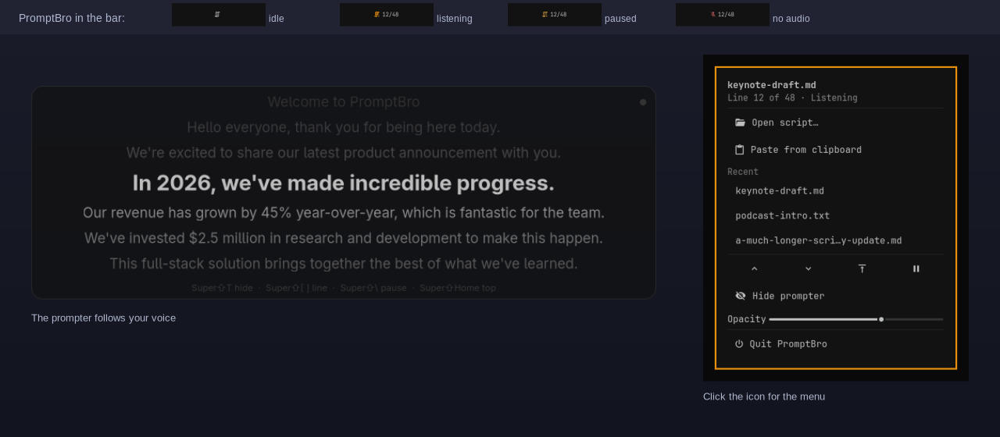

# PromptBro

A teleprompter for [Omarchy](https://omarchy.org) that follows your voice.

Click the script icon in the bar, open a script, and PromptBro shows it a few lines at a time
under the bar. It listens to your microphone and scrolls as you speak, so you can look at the
camera instead of at a scrollbar. Speech recognition runs on your machine
([sherpa-onnx](https://github.com/k2-fsa/sherpa-onnx)): no cloud, no account, no GPU.



## What it does

- **Follows what you say.** Each recognized word moves a cursor through the script. Ad-libs,
  stumbles, filler words and skipped lines are tolerated: it holds its place, and catches up
  when you rejoin the script. Numbers, years, currencies and abbreviations match how they are
  spoken ("2026" or "twenty twenty-six", "Q4", "$2.5 million").
- **Stays out of the way.** A translucent, click-through panel shows the current line large with
  a few lines of context. It fades in and out, can be hidden from screen shares and
  screenshots, and opens on whichever monitor has focus.
- **Lives in the bar.** The icon shows whether PromptBro is listening. States differ by shape
  and brightness, not only color: an outline script when nothing is loaded, a filled script
  with a line counter while listening, a dimmed one when paused, a microphone-off glyph when no
  audio arrives, and an alert on error.
- **Works from the keyboard too.** Hotkeys for toggle, pause, next line, previous line and
  restart (below).

## What's new in 0.3.0

- The file picker works on real desktop portals.
- PromptBro never uses a Bluetooth microphone unless you pin one.
- It survives display hotplug (works around a GTK 4.22.4 crash).
- Status heartbeat, launch-race and watchdog fixes.
- The bar icon hides itself when idle, like the other widgets.
- Hotkey legend in the menu, and an opacity slider.

## Install

```bash
omarchy plugin add https://github.com/supercleanse/promptbro --enable
```

Run interactively, `--enable` asks which bar section to use (center by default). To install
without enabling, drop `--enable` and run `omarchy plugin enable supercleanse.promptbro` later.

Then open the PromptBro menu from the bar and choose **Set up PromptBro...**, or run
`promptbro setup` in a terminal. Setup is safe to run again. It:

1. checks the system packages below and, if any are missing, prints the `sudo pacman -S --needed`
   line and stops (it never runs `sudo` itself);
2. creates a Python virtual environment at `~/.local/share/promptbro/venv` and installs the
   pinned packages from `requirements.txt`;
3. downloads the speech model (about 460 MB) from the sherpa-onnx GitHub releases and checks its
   SHA-256;
4. writes a default `~/.config/promptbro/config.toml` if you have none;
5. adds an app-launcher entry and a `~/.local/bin/promptbro` link (skip with `--no-desktop`);
6. prints the Hyprland lines for the hotkeys. It never edits your Hyprland files.

If the menu says setup is needed after an Arch Python upgrade, run setup again; it rebuilds the
environment.

## The menu

Click the bar icon:

| Item | What it does |
|:--|:--|
| Open script... | Pick a `.txt` or `.md` file. The prompter opens on it and starts listening. |
| Paste from clipboard | Use the clipboard text as the script (`wl-paste`). |
| Recent | The last eight scripts you opened. |
| Up, Down, Top, Pause | Move one line either way, restart from the top, pause or resume the microphone. |
| Show / Hide prompter | Toggle the panel without losing your place. |
| Opacity | Panel background opacity (text stays fully opaque). |
| Quit PromptBro | Stops listening and exits. |

Nothing runs until you use it. With no prompter running, the icon is dim and the menu still
works.

## Hotkeys

PromptBro does not edit your Hyprland config. Print the lines with your install path filled in:

```bash
promptbro --print-hypr-snippet
```

and paste them into `~/.config/hypr/bindings.lua` (and the two layer rules into
`hyprland.lua`). The default keys:

| Key | Action |
|:--|:--|
| `SUPER + SHIFT + T` | show or hide the prompter (starts it, loading your most recent script, if it isn't running) |
| `SUPER + SHIFT + \` | pause or resume |
| `SUPER + SHIFT + ]` | next line |
| `SUPER + SHIFT + [` | previous line |
| `SUPER + SHIFT + Home` | restart from the top |

Key names are xkb keysyms spelled the way Omarchy's own bindings spell them (`backslash`,
`bracketleft`, `bracketright`, `Home`); the all-caps forms never fire. Except for toggle and
show, a control key does nothing when PromptBro is not running.

## Update

```bash
omarchy plugin update supercleanse.promptbro
promptbro setup
```

The second command is only needed when the update changes `requirements.txt` or the model; the
menu tells you when it does.

## Remove

```bash
promptbro uninstall-data        # venv and models (asks first); add --all for config and state
omarchy plugin remove supercleanse.promptbro
```

Then delete the PromptBro lines from `~/.config/hypr/bindings.lua` and `hyprland.lua` by hand.
`promptbro uninstall-data` also removes the launcher entry, the icon, and the
`~/.local/bin/promptbro` link when it points into the plugin.

## What it needs

Omarchy (Quickshell shell, Hyprland) on Arch with Python 3.14. System packages, all in the
official repositories:

| Package | Why |
|:--|:--|
| `gtk4`, `gtk4-layer-shell` | the prompter window |
| `python-gobject`, `python-cairo` | GTK from Python |
| `gst-plugins-base`, `gst-plugin-pipewire` | microphone capture |
| `wl-clipboard` | Paste from clipboard |
| `libnotify` | error notifications |
| `glib2` | `gdbus` for the menu actions |

Python packages, pinned in `requirements.txt` and installed into the plugin's own virtual
environment: `sherpa-onnx`, `numpy`, `rapidfuzz`, `metaphone`, `num2words`.

Speech model: `sherpa-onnx-nemotron-speech-streaming-en-0.6b-160ms-int8` (English, streaming),
about 460 MB downloaded once from the sherpa-onnx GitHub releases with a pinned SHA-256. Smaller
or lower-latency alternatives are listed in `promptbro/models.py`; set `[asr] model` in the config
and run `promptbro setup`. On a busy machine the 80 ms NeMo model uses less CPU.

Everything PromptBro writes lives in these places, and nowhere else:

| Path | Contents |
|:--|:--|
| `~/.config/promptbro/config.toml` | your settings |
| `~/.local/share/promptbro/` | venv and models |
| `~/.local/state/promptbro/` | log (1 MB, 3 old copies kept), recent scripts, last position |
| `$XDG_RUNTIME_DIR/promptbro/` | live status file the bar icon reads |
| `~/.local/share/applications/`, `~/.local/share/icons/`, `~/.local/bin/promptbro` | optional launcher entry, icon, command link |

It uses the standard XDG variables when they are set. It needs no `sudo`, runs no background
service, and sends nothing over the network after the model download.

## Configuration

Edit `~/.config/promptbro/config.toml`. The common settings:

- **`[window]`**: `monitor` (`"auto"` follows the focused monitor; a connector name such as
  `"DP-1"` pins it), `width`, `height`, `top_gap`, `opacity` (0.3 to 1.0), `click_through`,
  `hide_from_screen_share`, `font`, `current_pt`, `other_pt`, `history_lines`, `upcoming_lines`,
  `animation_ms`, `show_legend` (the dim hotkey line along the bottom).
- **`[asr]`**: `model`, `models_dir`, `num_threads`, `device`, `endpoint_rule2_s`.
  `device = "auto"` (the default; empty means the same) uses the system default microphone
  unless it is Bluetooth, then the best USB/external one, then the built-in mic. PromptBro never
  opens a Bluetooth mic on its own: that would switch AirPods from music to call mode. Pin one
  with a node name, a glob, or a stable substring such as `"Studio_Display"`; a missing pin falls
  back to auto. The choice is re-made at every start and resume, and shown as `worker.device`
  in `promptbro status` and in the log.
- **`[aligner]`**: `tail_tokens`, `ahead_units`, `display_coasting`, `line_complete_on_final`.
- **`[log]`**: `level`.

`docs/DESIGN.md` describes every option and its default. Theme colors come from the current
Omarchy theme; run `promptbro reload-theme` after switching themes.

## Command line

`promptbro <verb>` talks to the running prompter. See `CONTRACT.md` for exit codes and the
machine-readable pieces.

| Command | What it does |
|:--|:--|
| `open <file>` | load a `.txt` or `.md` script, show the panel, start listening |
| `paste` | load the clipboard as the script |
| `show`, `hide`, `toggle` | panel visibility (`show` and `toggle` start PromptBro if needed) |
| `pause`, `resume` | freeze the position and microphone, or continue |
| `next`, `prev`, `restart`, `goto <n>` | move the cursor |
| `status` | print JSON status (`{"running": false, ...}` when not running) |
| `opacity <0.3-1.0>` | set the panel background opacity |
| `reload-theme` | re-read Omarchy's colors |
| `quit` | stop listening and exit |
| `doctor [--json]` | check the install and say how to fix what is missing |
| `setup [--dev] [--no-desktop]` | install or repair (above) |
| `pick-file` | file chooser used by the menu |
| `uninstall-data [--all] [--yes]` | remove what setup created |
| `--demo` | run on a built-in sample script |
| `--version` | print the version |

## Development

```bash
git clone https://github.com/supercleanse/promptbro
cd promptbro
scripts/dev-install.sh      # link the checkout into ~/.config/omarchy/plugins/
promptbro setup --dev       # venv with pytest, model, launcher
tests/run.sh                # pytest + node --test + plugin validate
```

`scripts/dev-install.sh` only creates the symlink and prints the commands to rescan and enable
the plugin; it never restarts your shell. `scripts/dev-uninstall.sh` removes that link.

Tests run offscreen (Broadway, a private D-Bus, a temp runtime directory) and never touch your
desktop, your microphone, or a running prompter. The bar widget and dropdown render offscreen
with canned data:

```bash
tests/offscreen/render.sh --fake-data tests/offscreen/out
~/.local/share/promptbro/venv/bin/python scripts/make_preview.py   # rebuilds preview.png
```

`docs/DESIGN.md` explains how the aligner and recognizer fit together; `docs/BUILD_LOG.md` is the
running implementation log.

## License

MIT. See [LICENSE](LICENSE).
